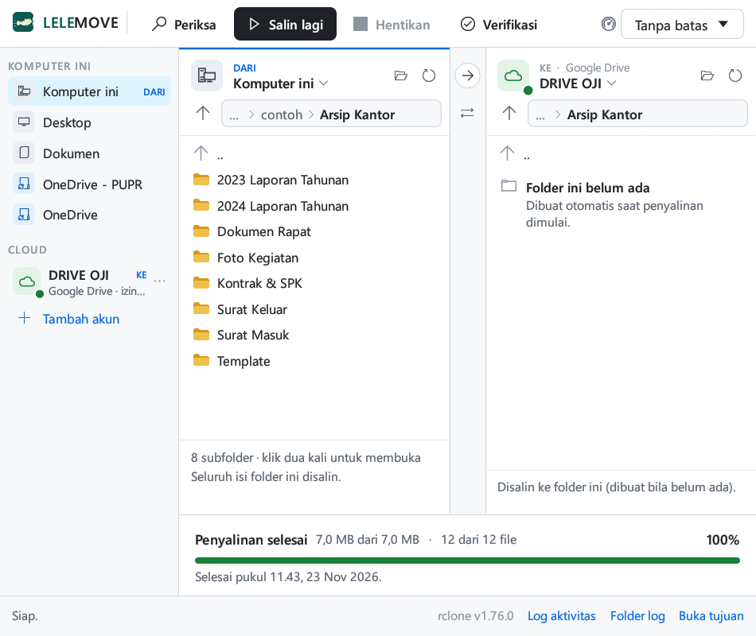

# LELEMOVE

*This is a short English overview. The full documentation is in Indonesian:
[README.md](README.md) (written in 1945-era spelling, on purpose) or
[README-ejaan-sekarang.md](README-ejaan-sekarang.md) (current spelling).*

LELEMOVE is a free, open-source desktop app for **Windows and macOS (beta)** that copies files
between cloud storage accounts and local folders, in any direction: OneDrive to Google Drive,
SharePoint to an office NAS, Dropbox to Backblaze B2, cloud to disk, and so on. It is a friendly
front end for [rclone](https://rclone.org), written in Rust with an egui window.



## What it does

- **29 storage services built in** (Google Drive, OneDrive, SharePoint, Dropbox, Box, pCloud, MEGA,
  Nextcloud, SMB/NAS, SFTP, FTP, S3, R2, B2, Azure Blob, ...), plus any other remote rclone supports.
- **Two-pane file manager** (*Dari* = From, *Ke* = To) for local and cloud folders.
- **Check before copying**: destination space and a dry run are checked first.
- **Background copying** with notifications, a speed limit, and automatic resume when the network drops.
- **Verification** of every file (checksums where the service has them), then an optional **Move**
  that deletes from the source only the files proven identical. Deleted files go to the Recycle Bin / Trash.
- **Filters**, **scheduled backups** (Task Scheduler on Windows, launchd on macOS), and
  **audit reports** (CSV and print-ready HTML).
- **Email migration and backup** (beta): Gmail, Outlook/Microsoft 365, or any IMAP server to your own
  mail server, or to `.eml` files on disk and back; `.mbox` files from Google Takeout or Thunderbird can be restored.
- **Command line** (`pindah.exe`) for everything above, with machine-readable output (`-Mesin`).
- **In-app updates**: the installer is downloaded from GitHub Releases and checked against its SHA-256 file.

The interface is in Indonesian.

## Install

Download the latest installer from [Releases](https://github.com/fauzirpl/lelemove/releases/latest):

- **Windows 10/11 64-bit**: `LELEMOVE-Setup-<version>.exe`. Per-user install, no admin rights needed.
- **macOS 11+ (beta, Apple Silicon and Intel)**: `LELEMOVE-<version>-macOS.dmg`.

The installers are **not code-signed yet**, so Windows SmartScreen and macOS Gatekeeper will warn on
first launch. Each release ships a `.sha256` file for both downloads.

For Google Drive you should create your own Google OAuth client ID (*Pengaturan > Client ID Google*);
the public installers do not bundle one, and the shared rclone client ID is heavily rate-limited.

## Privacy

LELEMOVE runs entirely on your computer. There is no LELEMOVE server, account, analytics, or
telemetry; data flows directly between your computer and the services you connect. See
[docs/privasi.md](docs/privasi.md) (Indonesian).

## Build from source

Windows, with the per-user Rust **GNU** toolchain (no Visual Studio needed):

```powershell
cd rust
cargo test --release --lib --bin pindah-drive
cd ..
.\buat-installer.ps1 -TanpaClient     # dist\LELEMOVE-Setup-<version>.exe
```

macOS: `./buat-dmg.sh` (needs the `aarch64-apple-darwin` and `x86_64-apple-darwin` targets).
Both builds also run in GitHub Actions on every push. See [CONTRIBUTING.md](CONTRIBUTING.md).

## License

[MIT](LICENSE). rclone and the bundled Rust crates keep their own licenses (listed in the app under
*Bantuan & info > Atribusi*). Service names are trademarks of their owners; LELEMOVE is not
affiliated with any storage provider or with Lalamove.
