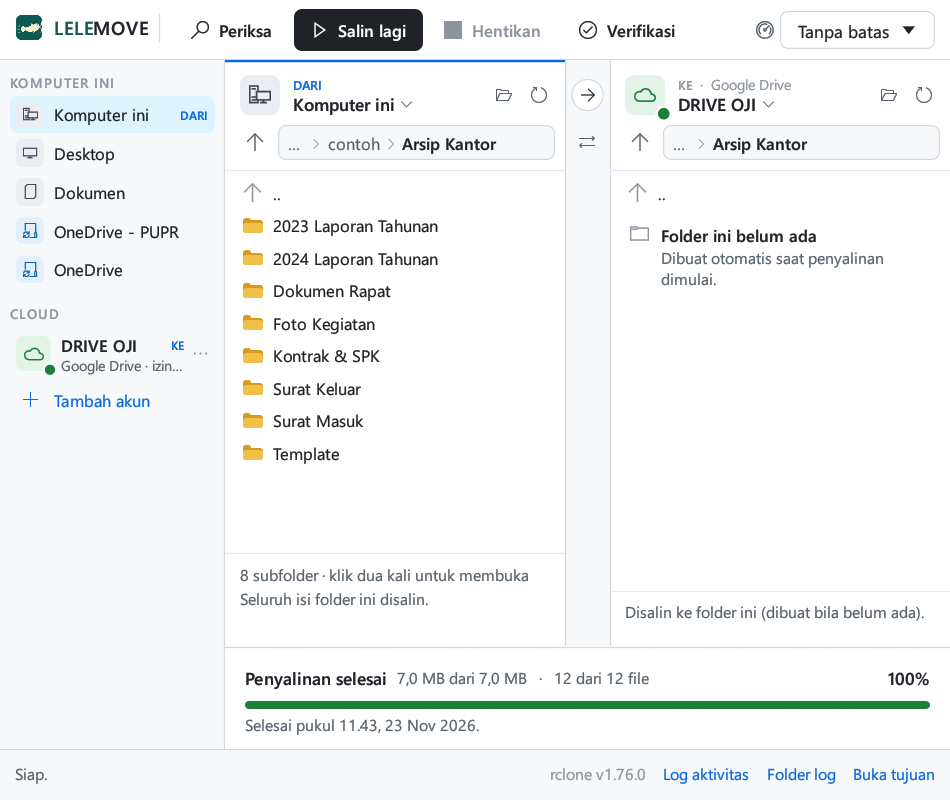

# LELEMOVE

Menyalin file antar **Google Drive**, **OneDrive**, **SharePoint**, **Dropbox**, **NAS/Nextcloud**,
**object storage S3**, layanan lain yang didukung rclone, dan **folder di komputer**, ke arah mana
pun, memakai [rclone](https://rclone.org). Contohnya OneDrive → Google Drive, SharePoint → NAS
kantor, Dropbox → Google Drive, folder komputer → Backblaze B2, atau cloud → komputer.
Lihat *Layanan yang didukung*.
Menyalin tidak mengubah atau menghapus file di sumber. File di sumber hanya dihapus bila Anda sendiri
memilih **Pindahkan** setelah verifikasi, dan itu pun masuk ke Recycle Bin / Sampah.

Versi 2 ditulis ulang dalam **Rust** (jendela memakai egui). Tidak lagi butuh PowerShell, jadi
tetap jalan di komputer kantor yang memblokir skrip.

Dulu bernama **Pindah Drive**. Namanya kini LELEMOVE (lele yang suka pindahan), ikonnya ikan lele
yang melaju. Nama internal tidak berubah: mesin `pindah.exe`, folder data `%LOCALAPPDATA%\pindah-drive`,
dan nama akun `pd-*` di rclone tetap sama, jadi akun dan pengaturan lama langsung terbaca.



## Pasang

Unduh **`LELEMOVE-Setup-<versi>.exe`** dari halaman
[**Releases**](https://github.com/fauzirpl/lelemove/releases/latest), jalankan, lalu klik *Pasang*
(atau *Perbarui* bila versi lama sudah terpasang; berkas PowerShell versi 1.x dibersihkan otomatis).

- Windows 10/11 64-bit. Dipasang untuk akun Windows Anda saja, di `%LOCALAPPDATA%\Programs\LELEMOVE`, tanpa hak admin.
- rclone sudah ikut di dalamnya, jadi tidak perlu mengunduh apa pun lagi.
- Muncul di Start Menu (dan Desktop bila dicentang), serta di *Settings > Apps*, tempat
  aplikasinya bisa dihapus lagi.
- Pemasangan diam-diam: `LELEMOVE-Setup-<versi>.exe /silent` (tambah `/nodesktop` bila
  tidak ingin pintasan Desktop).
- Akun, pengaturan, dan riwayat penyalinan dari versi 1.x tetap terbaca (format datanya sama).
- Bila sebelumnya terpasang dengan nama lama di `Programs\Pindah Drive`, installer memindahkannya ke
  `Programs\LELEMOVE` dan mengganti pintasan "Pindah Drive" dengan "LELEMOVE".

- Installer di Releases **tidak membawa client ID Google**. Agar penyalinan Google Drive tidak
  macet karena dibatasi, buat client ID sendiri lewat *Pengaturan > Client ID Google* (lihat
  [Penyalinan macet? Pakai client ID Google sendiri](#penyalinan-macet-pakai-client-id-google-sendiri)).

Installer belum ditandatangani secara digital, jadi Windows SmartScreen memperingatkan saat
pertama dibuka; klik *More info* > *Run anyway*. Keaslian unduhan bisa dicek dengan
`Get-FileHash .\LELEMOVE-Setup-<versi>.exe -Algorithm SHA256` lalu dicocokkan dengan berkas
`.sha256` di halaman rilis yang sama.

## Cara memakai

Jendelanya mirip pengelola file dua panel: **daftar lokasi** di kiri, panel **Dari** (sumber)
dan **Ke** (tujuan) berdampingan, toolbar di atas, dan bilah penyalinan di bawah.

- **Akun.** Di daftar kiri, klik *Tambah akun* lalu pilih Google Drive, OneDrive, SharePoint,
  atau *Layanan lain* (Dropbox, NAS, S3, dan lainnya), beri nama (misalnya "Pribadi" atau
  "Kantor"), lalu login di browser atau isi data loginnya. Satu jenis boleh berisi lebih dari satu akun. Saat aplikasi dibuka, setiap akun diuji: titik
  hijau di ikonnya berarti siap; **"login kedaluwarsa"** (merah) berarti perlu klik **Login
  ulang**; **"jaringan terputus"** (kuning) diuji ulang sendiri. Tombol **⋯** di tiap akun (atau
  klik kanan) berisi: buka di panel Dari/Ke, login ulang, beri izin penuh, dan lepas.
- **Pengaturan** (ikon ⚙ di dasar daftar kiri). Berisi **Client ID Google** (pasang, ganti,
  atau hapus client ID aplikasi, dan lihat akun Google mana yang sudah memakainya; client ID
  tidak lagi diatur per akun) dan **Penyalinan > Lanjutkan otomatis bila jaringan putus**.
- **Riwayat & laporan** (ikon jam di dasar daftar kiri). Semua penyalinan, verifikasi, dan
  pemindahan, beserta laporan CSV dan siap cetak. Lihat *Riwayat & laporan* di bawah.
- **Jadwal backup** (ikon kalender di dasar daftar kiri). Menyalin otomatis setiap hari atau
  pada hari tertentu, tanpa perlu membuka aplikasi. Lihat *Jadwal backup otomatis* di bawah.
- **Bantuan & info** (ikon ? di atas Pengaturan). Dialog bertab: *Tanya jawab*, *Ketentuan*
  penggunaan, kebijakan *Privasi*, *Atribusi* (komponen, layanan/API, dan semua pustaka Rust
  beserta lisensinya), dan *Tentang* (versi, folder aplikasi, data, dan log).
- **Dari mana, ke mana.** Klik panel Dari atau Ke (garis biru di atasnya menandai panel
  aktif), lalu klik lokasi di daftar kiri: *Komputer ini*, Desktop, Dokumen, folder OneDrive
  yang tersinkron, atau salah satu akun. Lokasi juga bisa diganti lewat nama lokasi di kepala
  panel. Klik dua kali folder untuk masuk, **↑** atau `..` untuk naik, dan klik nama folder di
  bilah alamat untuk kembali; klik ruang kosong bilah alamat untuk mengetik alamatnya. Yang
  disalin adalah **seluruh isi folder yang sedang dibuka** di panel Dari, ke folder yang sedang
  dibuka di panel Ke (dibuat bila belum ada). Tombol **⇄** di antara panel menukar sumber dan
  tujuan; ikon map terbuka di kepala panel membuka jendela pilih folder.
- **Salin.** Klik *Mulai salin* di toolbar. Aplikasi otomatis memeriksa ukuran, ruang tujuan,
  dan menjalankan uji coba dulu (bisa juga lewat *Periksa*), lalu menampilkan jumlah file yang
  akan disalin untuk Anda setujui. Penyalinan berjalan di latar belakang, jadi aplikasi boleh
  ditutup; Windows menampilkan notifikasi saat penyalinan selesai atau berhenti karena galat.
  Batas kecepatan di kanan toolbar (Tanpa batas, 1, 5, atau 10 MB/dtk) menjaga internet tetap
  lancar untuk keperluan lain; pilihannya diingat dan berlaku saat penyalinan dimulai atau
  dilanjutkan.
- **Filter.** Di bawah panel Dari, klik *Filter…* untuk menyalin hanya jenis file tertentu,
  melewati pola tertentu, atau hanya file yang diubah sejak tanggal tertentu. Lihat *Filter file*.
- **Verifikasi.** Berjalan otomatis setelah penyalinan selesai; bisa juga diklik di toolbar.
- **Pindahkan (opsional).** Setelah verifikasi, tautan *Pindahkan: hapus … file ini dari sumber*
  menghapus dari sumber file yang terbukti sama di tujuan. Lihat *Pindahkan*.

*Hentikan* menghentikan penyalinan. *Lanjutkan* meneruskannya, dan file yang sudah sampai dilewati.
*Log aktivitas* di bilah status bawah membuka catatan lengkap setiap langkah.

## Cara kerja penyalinan

Antar akun yang berbeda (misalnya OneDrive → Google Drive), data **dialirkan lewat komputer ini**:
rclone mengunduh dan mengunggah sekaligus dalam potongan 64 MB di memori, tanpa menyimpan
berkas utuh ke disk. Jadi kuota internet terpakai dua kali (unduh + unggah), dan komputer harus
tetap menyala (aplikasi mencegah Windows tidur selama menyalin).

### Jaringan putus: lanjut otomatis

rclone sendiri mencoba ulang gangguan singkat. Bila putusnya lebih lama sampai rclone berhenti,
proses penyalinan latar LELEMOVE memutuskan dari **galat terakhir** di log percobaan itu:

| Galat terakhir | Tindakan |
|---|---|
| Jaringan (DNS menolak, `no such host`, `dial tcp`, `i/o timeout`, koneksi putus, ...) | Tunggu, lalu lanjut otomatis |
| Login kedaluwarsa (`invalid_grant`) | Berhenti: perlu *Login ulang* |
| Batas unggah harian Google (750 GB) | Berhenti: lanjutkan besok |
| Galat lain (mis. izin ditolak) | Berhenti dan kabari lewat notifikasi |

Saat menunggu, jeda bertambah: 30 detik, 1, 2, 5, lalu 10 menit. Setelah jeda, LELEMOVE menguji
sambungan ke server layanan yang dipakai (`www.googleapis.com` / `graph.microsoft.com`, DNS + TCP
443) tiap 15 detik dan baru menjalankan rclone lagi setelah tersambung. File yang sudah sampai
dilewati. Batasnya 25 percobaan, atau 6 jam tanpa internet dalam satu jeda. Selama menunggu,
bilah penyalinan menampilkan **"Menunggu jaringan"** (kuning) beserta perkiraan jam percobaan
berikutnya; *Hentikan* tetap bisa dipakai. Notifikasi Windows muncul sekali saat jaringan pertama
kali putus. Di log tercatat baris `LELEMOVE: jaringan terputus ...` dan `... penyalinan
dilanjutkan`. Matikan lewat *Pengaturan > Penyalinan* (`"LanjutOtomatis": false` di
`pengaturan.json`); penyalinan dari konsol tanpa `-Latar` tidak pernah melanjutkan sendiri.

## Layanan yang didukung

*Tambah akun > Layanan lain* menampilkan semua layanan di bawah (bisa dicari). Kolom *Pindahkan*
menyebut ke mana file pergi saat dihapus dari sumber; "–" berarti layanan tanpa tempat sampah,
sehingga Pindahkan ditolak di sana.

| Kelompok | Layanan | Login | Pindahkan |
|---|---|---|---|
| Cloud | Google Drive, OneDrive, SharePoint | Browser | Sampah / recycle bin |
| Cloud | Dropbox, Box, pCloud, Yandex Disk | Browser | File terhapus / Sampah |
| Cloud | HiDrive, Zoho WorkDrive (beta) | Browser | – |
| Cloud | MEGA | Email + kata sandi (+ kode 2FA) | Rubbish Bin |
| Cloud | Koofr | Email + kata sandi aplikasi | – |
| Cloud | iCloud Drive (beta) | Apple ID + kata sandi, lalu kode 2FA | – |
| Cloud | Proton Drive (beta) | Email + kata sandi (+ kode 2FA) | Sampah |
| Cloud | Jottacloud (beta) | Token login dari situsnya (ditanyakan) | – |
| Server & NAS | Nextcloud, ownCloud | Alamat WebDAV + kata sandi aplikasi | Sampah |
| Server & NAS | WebDAV lain, SMB/NAS, SFTP, FTP/FTPS, Seafile | Alamat + pengguna + kata sandi | – |
| Object storage | Amazon S3, Cloudflare R2, Wasabi, MinIO, DigitalOcean Spaces, S3 lain | Access key + secret (+ endpoint) | – |
| Object storage | Backblaze B2 | Key ID + application key | Versi tersembunyi B2 |
| Object storage | Azure Blob Storage | Nama storage account + access key | – |

- **Layanan lain dari rclone** (lebih dari 70): *Buat lewat rclone config* membuka jendela
  `rclone config`. Sesudahnya, *Pakai remote rclone yang sudah ada* memasukkannya ke LELEMOVE.
  Remote seperti itu tetap milik Anda: *Lepas* hanya berhenti memakainya, tidak menghapusnya.
- **Folder bersama yang sudah bisa dibuka di Explorer** (`\\server\share`) bisa langsung dipakai
  lewat *Komputer ini*. Pilih *SMB/NAS* hanya bila perlu login dengan akun berbeda.
- **Isian rahasia** (kata sandi, secret) dikirim dari jendela ke `pindah.exe` lewat stdin, lalu
  diobfuskasi lewat `rclone obscure -` sebelum masuk `rclone config create`. Jadi kata sandi tidak
  pernah tampil polos di argumen proses. Obfuskasi bukan enkripsi; pakai kata sandi aplikasi bila ada.
- **Pertanyaan lanjutan** (kode 2FA iCloud, token Jottacloud, pilihan) datang dari mesin
  konfigurasi rclone (`config create --non-interactive` → `config update --continue`) dan tampil
  sebagai dialog. Akun baru yang gagal tersambung dihapus lagi.
- Layanan tanpa info kuota (FTP, S3, B2, ...) tetap bisa diperiksa: kuotanya ditulis "tidak dilaporkan".
- Saat jaringan putus, server sendiri (NAS, SFTP, Nextcloud, S3 lain) diuji ke host dan port dari
  konfigurasi akunnya; layanan cloud ke server API-nya.

## Filter file

| Isian | Contoh | Arti |
|---|---|---|
| Hanya jenis file ini | `pdf, docx, xlsx` | Hanya ekstensi ini yang disalin (huruf besar-kecil sama saja). Kosong = semua. |
| Lewati | `*.tmp, Arsip Lama/, node_modules/` | Pola yang tidak disalin. Akhiran `/` = folder beserta isinya; `*` = teks apa saja. |
| Hanya yang diubah sejak | `31-01-2026` | Hanya file yang tanggal ubahnya pada/sesudah tanggal itu. |

Filter disimpan di `pengaturan.json` (`Filter`) dan dipakai sama persis oleh periksa, uji coba,
salin, verifikasi, dan pindahkan; file yang sengaja tidak disalin tidak dilaporkan "belum ada di
tujuan". Saat filter jenis atau tanggal aktif, folder kosong di sumber tidak ikut dibuat di tujuan
(rclone akan membuat *semua* subfolder walau isinya tidak ada yang lolos). File sistem
(`desktop.ini`, `Thumbs.db`, berkas kunci Office `~$*`) selalu dilewati. Jadwal backup menyimpan
salinan filternya sendiri (*Pakai folder & filter yang sedang dibuka*).

## Riwayat & laporan

Setiap penyalinan (termasuk yang dihentikan, gagal, atau dilewati jadwal), verifikasi, dan
pemindahan dicatat sebagai satu baris di `%LOCALAPPDATA%\pindah-drive\riwayat.jsonl`. Riwayat tidak
dihapus otomatis.

- **Laporan per file** (pada verifikasi/pindahkan): halaman HTML siap cetak berisi rute, waktu,
  metode (checksum atau nama & ukuran), filter, ringkasan, dan status **setiap file**, yang
  bermasalah ditampilkan lebih dulu. Simpan sebagai PDF lewat *Ctrl+P* di browser. Cocok sebagai
  bukti audit bahwa salinan lengkap.
- **CSV per file**: daftar yang sama untuk Excel (UTF-8, pemisah koma).
- **Ekspor CSV / Laporan HTML**: seluruh riwayat yang tampil (bisa disaring: Salin, Verifikasi,
  Pindahkan).

Daftar per file dibaca dari berkas `verifikasi-*.txt` di folder log, yang ikut terhapus setelah
60 hari; ringkasannya tetap ada di riwayat.

## Pindahkan (hapus sumber setelah verifikasi)

Opsional dan selalu atas permintaan Anda. Muncul sebagai tautan di bawah hasil verifikasi bila ada
file yang cocok, dengan dua kali konfirmasi (yang kedua: ketik `HAPUS`).

1. LELEMOVE **memverifikasi ulang** saat itu juga (hasil verifikasi sebelumnya bisa basi).
2. Hanya file berstatus *cocok persis* yang dihapus dari **sumber**. File yang belum ada, berbeda,
   gagal dibaca, atau file Office yang metadatanya diubah SharePoint tidak disentuh.
3. Ke mana perginya: folder komputer → **Recycle Bin**; Google Drive → **Sampah** (30 hari);
   OneDrive/SharePoint → **recycle bin** layanan itu. Folder yang menjadi kosong ikut dihapus;
   folder yang memang kosong sejak awal dibiarkan.
4. Folder sumber di drive jaringan atau flashdisk ditolak, karena di sana tidak ada Recycle Bin.

Tujuan tidak pernah dihapus apa pun. Jadwal backup tidak bisa memindahkan (selalu menyalin).

## Jadwal backup otomatis

Buka folder yang mau dicadangkan di panel **Dari** dan tujuannya di panel **Ke**, lalu klik
**Jadwal backup > Jadwal baru**. Isi nama, jam (kelipatan 5 menit), hari (semua hari = setiap
hari), dan apakah hasilnya diverifikasi. Rute jadwal disimpan terpisah, jadi panel Dari/Ke boleh
diganti sesudahnya tanpa mengubah jadwal. Di daftar jadwal ada *Jalankan sekarang*, *Ubah*,
*Nonaktifkan*/*Aktifkan*, dan *Hapus*, beserta hasil terakhir dan tautan ke log-nya.

Cara kerjanya:

| Bagian | Keterangan |
|---|---|
| Pemicu | Satu tugas **Task Scheduler** per jadwal, bernama `LELEMOVE - Backup <id>`, milik pengguna Windows yang sedang masuk (tanpa hak admin, "Interactive only"). |
| Yang dijalankan | `LELEMOVE.exe --jadwal <id>` → `pindah.exe jadwal -Jalankan -Id <id>` tersembunyi. |
| Komputer mati/tidur pada jamnya | Dijalankan begitu komputer menyala lagi (*StartWhenAvailable*). Komputer tidak dibangunkan. |
| Penyalinan lain sedang berjalan | Jadwal ini dilewati (tercatat "dilewati" + notifikasi), dicoba lagi pada jadwal berikutnya. |
| Jaringan putus | Sama dengan penyalinan latar: lanjut otomatis (bila aktif di Pengaturan). |
| Hasil | Notifikasi Windows: selesai (jumlah file baru, hasil verifikasi), ada selisih, atau gagal. Bila aplikasi terbuka, bilah bawah menampilkan "Backup terjadwal ...". |
| Penyimpanan | `%LOCALAPPDATA%\pindah-drive\jadwal.json` (daftar + hasil terakhir); log di folder `log\jadwal-*.log`. |

Yang disalin hanya file baru atau yang berubah; tidak ada yang dihapus di tujuan. Uninstall
menghapus tugas Windows milik folder aplikasi itu, tetapi `jadwal.json` tetap ada: bila LELEMOVE
dipasang lagi, jadwal tampil "tugas Windows hilang" dan cukup diklik *Aktifkan*. Jadwal hanya
berjalan selama Anda masuk ke Windows (layar terkunci tidak apa-apa).

## SharePoint

Klik **+ SharePoint**, login dengan akun Microsoft kantor/sekolah, lalu cari situsnya. Anda
bisa mengetik namanya (misalnya "pupr") atau menempel alamatnya dari browser
(`https://namatenant.sharepoint.com/sites/NamaSitus`). Pilih situs dan **pustaka dokumennya**
(biasanya "Dokumen"). Satu akun SharePoint mewakili satu pustaka; untuk pustaka lain, tambah akun
SharePoint lagi atau ganti lewat *⋯ > Pilih situs & pustaka…* pada akun itu.

- Yang tersalin hanya file dan folder. Riwayat versi, izin berbagi, metadata kolom, list,
  dan halaman situs tidak ikut.
- Untuk menyalin dari SharePoint cukup hak *baca*; untuk menyalin ke SharePoint perlu hak *edit*.
- Bila SharePoint menjadi tujuan, SharePoint menambahkan metadata ke file Office
  (.docx/.xlsx/.pptx), sehingga ukurannya berubah. LELEMOVE memakai `--ignore-size
  --ignore-checksum` saat menyalin ke SharePoint, dan saat verifikasi file Office semacam itu
  dihitung cocok, disertai catatan.
- SharePoint sering membatasi laju (throttling, HTTP 429). rclone menunggu lalu mencoba lagi.
- Cara tanpa login tambahan: di SharePoint klik **Sync** atau **Add shortcut to My files**,
  lalu pilih folder hasilnya lewat *Komputer ini*.

## Izin akun

| Akun | Sebagai tujuan | Sebagai sumber |
|---|---|---|
| Google Drive, izin terbatas (`drive.file`) | Ya | Tidak: hanya bisa melihat file buatan LELEMOVE |
| Google Drive, izin penuh (`drive`) | Ya | Ya |
| OneDrive pribadi / kantor | Ya | Ya |
| SharePoint (satu pustaka dokumen) | Ya, bila punya hak edit | Ya |
| Komputer ini | Ya | Ya |

Izin terbatas adalah pilihan bawaan dan paling aman untuk akun yang hanya menjadi tujuan.
Untuk menyalin *dari* Google Drive, beri izin penuh lewat *⋯ > Beri izin penuh* pada akun itu.

Akun OneDrive kantor sebenarnya punya beberapa "drive" (pustaka SharePoint), seperti
`PersonalCacheLibrary` dan `Pustaka Penangguhan Preservasi`. LELEMOVE otomatis memilih
OneDrive utama, yaitu drive yang alamatnya berakhir `/Documents` ("Dokumen" atau "Documents"
tergantung bahasa), lalu menampilkan nama drive itu di daftar akun.

## Penyalinan macet? Pakai client ID Google sendiri

Gejalanya: progres berhenti di angka tertentu dengan kecepatan 0, sementara
aplikasi menampilkan "Tidak ada kemajuan sejak ..." atau "membatasi permintaan (rate limit)".

Penyebabnya: rclone memakai satu **client ID Google bersama** untuk semua penggunanya di seluruh
dunia. Client ID itu sedang dipensiunkan Google dan kuota per menitnya sering habis
(`Error 403: Quota exceeded ... rateLimitExceeded`). Selama kuota habis, rclone hanya bisa
menunggu dan mencoba lagi.

Solusinya adalah client ID sendiri. Gratis, kuotanya khusus untuk Anda, dan cukup dibuat
sekali (sekitar 5 menit). Buka **Pengaturan > Client ID Google > Pasang client ID…**; dialognya
berisi langkah-langkah beserta tautan ke Google Cloud Console:

1. Buat project baru di Google Cloud.
2. Aktifkan Google Drive API.
3. Isi *Branding* (nama aplikasi dan email Anda), pilih Audience *External*.
4. Di *Clients*, buat client jenis *Desktop app*, lalu tempel Client ID dan secret-nya ke aplikasi.
   Google hanya menampilkan secret sekali, saat client dibuat. Simpan dengan *Download JSON*.
5. Di *Audience*: selama status *Testing*, tambahkan email setiap akun Google pemakai di
   *Test users* (maksimal 100). **Login dalam mode Testing kedaluwarsa setelah 7 hari**; aplikasi
   menandainya dengan titik merah dan tombol *Login ulang*. Agar tidak kedaluwarsa dan akun lain
   bisa login tanpa didaftarkan, klik *Publish app*. Google meminta alamat beranda dan kebijakan
   privasi di *Branding*, tetapi untuk izin `drive.file` tidak perlu verifikasi. Izin penuh
   (`drive`) tetap memunculkan layar "aplikasi belum diverifikasi".

Saat login, Google bisa menampilkan *"Google hasn't verified this app"*. Karena aplikasinya milik
Anda sendiri, klik *Continue* atau *Advanced* lalu *Go to … (unsafe)*.

### Pengaturan > Client ID Google

Client ID Google diatur **sekali untuk seluruh aplikasi**, di *Pengaturan* (ikon ⚙ di dasar daftar
lokasi), bukan lagi lewat menu ⋯ tiap akun atau dialog tambah akun.

| Di Pengaturan | Artinya |
|---|---|
| **Terpasang** `1234…` (dari komputer ini) | Client ID disimpan lewat Pengaturan di komputer ini. |
| **Terpasang** `1234…` (dari installer) | Client ID ikut dibawa installer; tidak bisa dihapus dari sini. |
| **Belum ada** | Akun Google memakai client ID bersama rclone (sering dibatasi). |
| *Pasang / Ganti client ID…* | Isi Client ID + secret; langsung tersimpan, tanpa login. |
| *Hapus* | Menghapus client ID yang disimpan di komputer ini (bawaan installer berlaku lagi bila ada). |
| *Ambil dari akun X* | Muncul bila belum ada client ID aplikasi tetapi akun X sudah memakai client ID sendiri. |
| Daftar *Akun Google* | Tiap akun: "memakai client ID aplikasi", "memakai client ID lain", atau "memakai client ID bersama". |
| *Login ulang dengan client ID ini* | Untuk akun yang belum memakai client ID aplikasi; browser terbuka untuk login. |

Client ID aplikasi:
- dipakai otomatis untuk setiap akun Google yang **ditambahkan** sesudahnya. Akun yang sudah ada
  baru ikut memakainya setelah *Login ulang dengan client ID ini*;
- disimpan di `%LOCALAPPDATA%\pindah-drive\client-google.json`. Lokasinya sengaja di luar folder
  proyek, karena folder proyek berada di web root Laragon;
- **ikut dibawa installer** saat `buat-installer.ps1` dijalankan. Rekan yang memasang langsung bisa
  login, asalkan email mereka sudah Anda tambahkan di *Test users* (atau aplikasinya sudah di-publish).

Pertimbangkan sebelum membagikan: siapa pun yang memegang installer bisa membaca client ID dan
secret itu, lalu ikut memakai kuota project Anda. Untuk client jenis *Desktop app*, Google
menganggap ini wajar, tetapi jangan unggah installer seperti itu ke tempat umum. Untuk installer
publik, gunakan `.\buat-installer.ps1 -TanpaClient`.

## Verifikasi: seberapa teliti?

| Sumber ↔ tujuan | Cara mencocokkan |
|---|---|
| Komputer ↔ Google Drive | checksum MD5 |
| Komputer ↔ OneDrive, OneDrive ↔ OneDrive | checksum QuickXorHash |
| Google Drive ↔ Google Drive | checksum MD5 |
| OneDrive ↔ Google Drive | nama & ukuran saja (tidak ada jenis checksum yang sama) |

Verifikasi tidak mengunduh ulang: checksum dibaca dari metadata yang disimpan tiap layanan.

## Batasan

- Kuota tujuan dicek sebelum menyalin. Isi sampah ikut dihitung dalam kuota.
- Google membatasi unggahan **750 GB per hari**. Penyalinan berhenti sendiri dan bisa
  dilanjutkan besok.
- Bila sumbernya folder OneDrive di komputer, file yang statusnya "hanya online" diunduh dulu
  ke disk. Aplikasi menghitung apakah ruang disknya cukup.
- **Notebook OneNote** dan **Personal Vault** tidak ikut tersalin.
- Dokumen Google (Docs/Sheets/Slides) yang disalin ke luar Google Drive diubah menjadi
  `.docx`/`.xlsx`/`.pptx`.

## Privasi

- Token login disimpan oleh rclone di `%APPDATA%\rclone\rclone.conf`. Jangan bagikan file ini.
- Pengaturan, status, dan log ada di `%LOCALAPPDATA%\pindah-drive\`. Log yang lebih tua dari
  60 hari dihapus otomatis setiap kali penyalinan dimulai, kecuali log penyalinan terakhir.
- *Lepas akun* hanya menghapus koneksi di komputer ini, bukan file di cloud. Untuk mencabut izin
  sepenuhnya, hapus akses "rclone" di <https://myaccount.google.com/permissions> atau di
  pengaturan akun Microsoft.

## Baris perintah

Semua yang ada di aplikasi juga bisa dijalankan lewat `pindah.exe` (di folder aplikasi):

```powershell
pindah akun                                             # daftar akun
pindah hubungkan -Akun pd-onedrive-2 -Jenis onedrive -Label "Kantor"
pindah hubungkan -Akun pd-gdrive -Ulang                 # login ulang (token kedaluwarsa)
pindah hubungkan -Akun pd-gdrive -IzinPenuh             # agar bisa jadi sumber
pindah klien                                            # client ID Google aplikasi + akun yang memakainya
pindah klien -ClientId X -ClientSecret Y                # simpan client ID aplikasi (tanpa login)
pindah klien -Hapus                                     # hapus client ID yang disimpan di komputer ini
pindah hubungkan -Akun pd-gdrive -ClientAplikasi        # login ulang memakai client ID aplikasi
pindah hubungkan -Akun pd-sharepoint -Jenis sharepoint  # login Microsoft
pindah situs -Akun pd-sharepoint -Cari pupr             # daftar situs (+ Id)
pindah pustaka -Akun pd-sharepoint -SitusId <Id>        # daftar pustaka (+ Id)
pindah pustaka -Akun pd-sharepoint -Pustaka <Id> -SitusNama PUPR -PustakaNama Dokumen
pindah periksa -Sumber "pd-gdrive:Arsip" -Tujuan "pd-onedrive:Pindahan Google Drive/Arsip"
pindah uji
pindah salin -Latar -Ya
pindah salin -Latar -Ya -BatasKecepatan 5M              # batasi 5 MB/dtk (diingat; "off" = tanpa batas)
pindah status
pindah verifikasi
pindah salin -Latar -Ya -Sertakan "pdf,docx" -Lewati "*.tmp,Arsip Lama/" -Sejak 2026-01-01   # filter (diingat)
pindah salin -Latar -Ya -TanpaFilter                    # hapus filter
pindah pindahkan                                        # verifikasi ulang + tampilkan berapa file yang akan dihapus
pindah pindahkan -Ya                                    # hapus dari SUMBER file yang cocok (ke Recycle Bin/Sampah)
pindah penyedia                                         # daftar layanan + isian masing-masing
pindah hubungkan -Akun pd-dropbox -Jenis dropbox        # layanan ber-login browser
'{"pass":"..."}' | pindah hubungkan -Akun pd-sftp -Jenis sftp -Opsi host=nas.kantor -Opsi user=admin -RahasiaStdin
pindah hubungkan -Akun pd-icloud -Lanjut -State <S> -Jawab 123456   # jawab pertanyaan lanjutan (kode keluar 10 = ada pertanyaan)
pindah impor                                            # remote rclone yang bisa dipakai
pindah impor -Akun kantorku -Label "Server lama"        # pakai remote rclone yang sudah ada
pindah riwayat [-Jumlah 50]                             # riwayat salin, verifikasi, pindahkan
pindah riwayat -Csv riwayat.csv | -Laporan laporan.html # ekspor semua
pindah riwayat -Id <id> -Laporan verifikasi.html        # laporan per file satu verifikasi (atau -Csv)
pindah jadwal                                           # daftar backup terjadwal
pindah jadwal -Tambah -Nama "Dokumen" -Sumber "D:\Data" -Tujuan "pd-gdrive:Arsip" -Jam 22:00 -Hari sen,rab,jum
pindah jadwal -Tambah -Id <id> ... [-TanpaVerifikasi]   # ubah jadwal yang ada (isian lengkap lagi)
pindah jadwal -Id <id> -Nonaktifkan                     # atau -Aktifkan (memasang ulang tugas yang hilang)
pindah jadwal -Id <id> -Jalankan                        # jalankan sekarang di konsol ini
pindah jadwal -Id <id> -Hapus
```

Sumber dan tujuan ditulis sebagai folder komputer (`D:\Data`) atau `<akun>:<folder>`.
Tanpa perintah (atau lewat `Pindah.cmd`), `pindah` membuka menu teks.

- `-BatasKecepatan` diteruskan ke rclone sebagai `--bwlimit`, dengan satuan 1024 per detik:
  `500K`, `5M`, `1.5M`; angka tanpa satuan berarti KB/dtk. Unggah dan unduh bisa dibedakan
  dengan `unggah:unduh`, misalnya `10M:5M`. Nilainya disimpan di `pengaturan.json`
  (`BatasKecepatan`) dan juga dipakai jendela aplikasi; `-BatasKecepatan off` menghapusnya.
- `salin -Latar` mengirim notifikasi Windows saat selesai atau berhenti karena galat, juga
  bila jendela aplikasi sudah ditutup. *Hentikan* tidak memunculkan notifikasi.
- `salin -Latar` melanjutkan sendiri saat jaringan putus (lihat *Jaringan putus: lanjut
  otomatis*); `status` lalu menampilkan `Keadaan: MENUNGGU JARINGAN` dan perkiraan jamnya.
- Setiap `salin` menghapus berkas di `%LOCALAPPDATA%\pindah-drive\log` yang lebih tua dari
  60 hari, kecuali log yang tercatat di `job.json`.
- `jadwal -Hari` menerima `setiap` (bawaan) atau nama hari dipisah koma: `sen,sel,rab,kam,jum,sab,min`
  (nama lengkap juga boleh). `-Jam` memakai format `22:00`. Jadwal memakai batas kecepatan yang
  tersimpan di `pengaturan.json` saat ia berjalan, dan tidak mengubah rute yang dibuka di jendela.

## Untuk pengembang

```
rust/                          kode sumber versi 2 (satu crate Rust)
  src/mesin/                   mesin: akun, rute, job & log rclone, semua perintah
  src/win.rs                   pembungkus Win32 (proses, mutex, folder dikenal, layar tetap menyala)
  src/gaya.rs                  tampilan egui bersama (warna, huruf Segoe UI, ikon Segoe MDL2, tombol)
  src/bin/pindah.rs            pindah.exe: baris perintah & menu teks
  src/mesin/lanjut.rs          lanjut otomatis saat jaringan putus (keputusan, jeda, uji sambungan)
  src/mesin/jadwal.rs          jadwal backup: jadwal.json, XML Task Scheduler, schtasks
  src/mesin/penyedia.rs        daftar layanan: backend rclone, isian, login, tempat sampah, host API
  src/mesin/filter.rs          filter file -> aturan --filter / --max-age rclone
  src/mesin/riwayat.rs         riwayat.jsonl, CSV, laporan HTML siap cetak
  src/bin/pindah-drive/        LELEMOVE.exe: jendela aplikasi (egui) + dialog
  src/bin/pindah-drive/info.rs dialog Bantuan & info (tanya jawab, ketentuan, privasi, atribusi, tentang)
  src/bin/pindah-drive/jadwal.rs dialog Jadwal backup (daftar + isian)
  src/bin/pindah-drive/filter.rs dialog Filter file
  src/bin/pindah-drive/riwayat.rs dialog Riwayat & laporan
  src/bin/pindah-drive/layanan.rs dialog Tambah akun layanan lain, isian, pertanyaan lanjutan, impor
  src/bin/setup.rs             installer; tanpa muatan menjadi uninstall.exe
  src/bin/tanam-ikon.rs        alat build: menanam ikon & manifest (UpdateResourceW)
  aset/app.manifest            asInvoker + Common Controls 6
  aset/atribusi.txt            daftar pustaka Rust + lisensi; dibuat ulang buat-installer.ps1 (cargo tree)
docs/                          tanya-jawab.md, ketentuan.md, privasi.md: ditanam ke aplikasi
                               (include_str!), dan privasi.md bisa dipakai sebagai halaman kebijakan
                               privasi untuk "Publish app" di Google Cloud Console
aset/ikon.ico                  ikon aplikasi (lele); dibuat ulang dengan: python aset\buat-ikon.py aset\ikon.ico pratinjau.png
buat-installer.ps1             membuat dist\LELEMOVE-Setup-<versi>.exe (rclone ikut dibundel;
                               -TanpaClient = tanpa client ID Google, untuk rilis publik)
skills/pindah-drive/SKILL.md   panduan untuk Claude; .claude-plugin/ = manifest plugin lokal
arsip-v1-powershell/           sumber versi 1.x (PowerShell + WPF + C#), tidak dipakai lagi
```

Build memakai toolchain Rust **GNU** per pengguna (tanpa Visual Studio):

```powershell
winget install Rustlang.Rustup --custom "--default-host x86_64-pc-windows-gnu --profile minimal"
.\buat-installer.ps1
```

Catatan toolchain: rustup GNU tidak membawa assembler `as.exe`, jadi crate yang me-link lewat
`raw-dylib`/`windows-link` tidak bisa dibangun. `Cargo.lock` mengunci beberapa crate ke versi
yang masih memakai import library biasa (lihat komentar di `rust/Cargo.toml`), dan `build.rs`
menyediakan `libshlwapi.a`. Uji unit: `cargo test --release --lib --bin pindah-drive` di folder
`rust`. Untuk menguji lanjut otomatis tanpa memutus internet: jalankan `salin -Latar` dengan
`HTTPS_PROXY=http://127.0.0.1:9` (semua permintaan rclone gagal seperti jaringan putus),
`PINDAH_DRIVE_JEDA_ULANG=3` (jeda dalam detik), dan `PINDAH_DRIVE_MAKS_ULANG=3`.

Untuk menguji jadwal tanpa menyentuh data asli: set `PINDAH_DRIVE_DATA` ke folder kosong, lalu
jalankan `target\release\pindah.exe jadwal -Tambah ...` dengan jam 1-2 menit dari sekarang.
Tugas yang dibuat saat variabel itu terpasang membawa `--data "<folder>"`, sehingga pemicu dari
Task Scheduler juga memakai folder uji. Picu tanpa menunggu: `schtasks /Run /TN "LELEMOVE - Backup <id>"`.
Hapus jadwal uji dengan `pindah jadwal -Id <id> -Hapus`.

Cara kerjanya: setiap tombol di jendela menjalankan `pindah.exe <perintah> -Mesin` sebagai proses
tersembunyi. Teks keluarannya masuk ke *Log aktivitas*, sedangkan satu baris `##HASIL {json}`
berisi angka hasilnya. Progres penyalinan dibaca dari `job.json` dan log rclone. Daftar folder
di panel Dari/Ke dimuat di thread latar (`rclone lsf --dirs-only` untuk cloud, `read_dir` untuk
komputer ini). Ikon memakai huruf Segoe MDL2 Assets bawaan Windows 10/11. Pratinjau jendela
untuk dokumentasi: `"LELEMOVE.exe" --pratinjau layar.png [--dialog client] [--log]
[--lebar 760] [--tinggi 820]`; pakai `PINDAH_DRIVE_DATA=<folder sementara>` agar data asli
tidak tersentuh.

Untuk menguji layanan berisian tanpa akun sungguhan: jalankan server lokal dengan rclone dan pakai
konfigurasi rclone terpisah (`RCLONE_CONFIG`), supaya `rclone.conf` asli tidak tersentuh:

```powershell
rclone serve webdav C:\uji\dav --addr 127.0.0.1:18081 --user uji --pass rahasia   # juga: serve sftp / ftp / s3 --auth-key AK,SK
$env:RCLONE_CONFIG = "C:\uji\rclone-uji.conf"; $env:PINDAH_DRIVE_DATA = "C:\uji\data"
'{"pass":"rahasia"}' | .\target\release\pindah.exe hubungkan -Akun pd-webdav -Jenis webdav -Opsi url=http://127.0.0.1:18081 -Opsi user=uji -RahasiaStdin
```

### Membuat rilis

Installer untuk publik **wajib** dibangun dengan `-TanpaClient`. Tanpa opsi itu, client ID dan
secret Google dari `%LOCALAPPDATA%\pindah-drive\client-google.json` ikut masuk ke installer.
Keduanya menulis ke nama berkas yang sama di `dist\`, jadi pindahkan dulu installer pribadi bila
masih dipakai.

```powershell
# 1. Naikkan "version" di rust\Cargo.toml (dan .claude-plugin\plugin.json), commit, lalu push.
# 2. Bangun installer publik dan checksum-nya.
.\buat-installer.ps1 -TanpaClient
$exe = ".\dist\LELEMOVE-Setup-<versi>.exe"
"$((Get-FileHash $exe -Algorithm SHA256).Hash.ToLower())  $(Split-Path $exe -Leaf)" | Set-Content -Encoding ascii "$exe.sha256"
# 3. Terbitkan (tag dibuat di commit terakhir main).
gh release create v<versi> $exe "$exe.sha256" --target main --title "LELEMOVE <versi>" --notes-file catatan-rilis.md
```

Memakai sebagai plugin Claude Code:

```powershell
claude plugin marketplace add C:\laragon\www\pindah-drive
claude plugin install pindah-drive@pindah-drive-lokal
```
